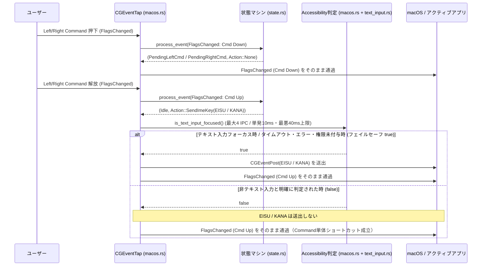

# 左右Command「英数/かな」のテキスト入力時限定発火 詳細設計書

本ドキュメントは、**m2us** における左右Commandキー単体タップ時の「英数 (`0x66`) / かな (`0x68`)」送出を**テキスト入力フォーカス時のみ**に限定し、非テキスト入力時は通常のCommandキーとして動作させるための詳細設計書である。

---

## 1. 背景と目的

### 1.1 現状の課題
現在の `m2us`（[`src/macos.rs`](src/macos.rs) / [`src/state.rs`](src/state.rs)）では、左右Commandキーの押下・解放イベント（`kCGEventFlagsChanged`）自体は消費せずOSへ通過させているが、単体タップ成立時（Command解放時）に無条件で `Action::SendKey(KEY_JIS_EISU)` / `Action::SendKey(KEY_JIS_KANA)` を実行し、`CGEventPost` でキーイベントを送出している。

これにより、以下の2つの問題が発生する：
1. **非テキスト入力時におけるCommand単体ショートカットとの競合**:
   Commandキーの単押し・2連打・長押し等をトリガーとするランチャーやユーティリティ（Raycast, Alfred, 音声入力ツール等）から見ると、Commandを離す瞬間に別キー（英数/かな）の `KeyDown` / `KeyUp` が割り込むため、「単体押し」と認識されずショートカットがキャンセルされる。
2. **非テキスト入力時の不要なIME切り替え**:
   Finderでのファイル操作中やブラウザ閲覧中など、文字入力を行っていない場面でCommandキーに指が触れるたびにIME状態（英数/かな）が意図せず切り替わる。

### 1.2 設計目標と基本方針（フェイルセーフ設計）
1. **テキスト入力時のみ「英数/かな」を発火**:
   現在フォーカスされているUI要素がテキスト入力を受け付けている場合のみ、`KEY_JIS_EISU` / `KEY_JIS_KANA` を送出する。
2. **非テキスト入力時は純粋なCommandキーとして動作**:
   非テキスト入力中と明確に判定された場合は `send_key` をスキップし、ネイティブの `kCGEventFlagsChanged`（Command Down / Up）のみをそのまま通過させる。
   > [!IMPORTANT]
   > **既知の制限（テキスト入力中のCommand単体ショートカット）**
   > テキスト入力欄にフォーカスがある状態では「英数/かな」の送出を行うため、**テキスト入力中はCommand単体ショートカットとの競合が引き続き発生する**。本設計でCommand単体ショートカットが解放されるのは「非テキスト入力時」のみである。
3. **フェイルセーフ方針：「迷ったら送る（`true`）」の徹底**:
   `m2us` の最優先責務は「日本語入力時の英数/かな切り替えを確実に機能させること」である。したがって、**「確実に非テキスト入力であると判定できた場合のみ送出をスキップ（`false`）し、タイムアウト・権限不足・未知のエラー・内部構造非公開のElectronアプリ等のグレーゾーンではすべて送出（`true`）に倒す」**というフェイルセーフ設計を採用する。これにより、万が一判定が失敗しても「現在の `m2us` と同じ挙動（常に送出）」に戻るだけであり、「文字を打ちたいのに英数/かなに切り替わらない」という致命的な不具合を防止する。
4. **CapsLock（単押しEsc / 長押しCapsLock）は従来通り常時有効**:
   `Esc` はモーダル操作（Vimノーマルモード、ダイアログを閉じる等）で非テキスト入力時にも必須であるため、テキスト入力判定の対象外とする。
5. **権限未付与・失効時のフォールバック（後方互換性）**:
   起動時または実行中にアクセシビリティ（`AXUIElement`）権限が未付与・失効している場合は、警告を出力した上で**従来の無条件送出モード（`true`）にフォールバック**する。
6. **`SPEC.md` の非機能要件の厳守**:
   - **外部クレート依存ゼロ (`[dependencies]` は空)**: `ApplicationServices`、`CoreFoundation`、および `libSystem` (`proc_pidpath`, `access`) のC FFIのみで実装する。
   - **アイドル時CPU使用率 0%・通常キー入力時の遅延ゼロ**: ポーリングや常時監視は行わず、**「左右Commandの単体タップが成立してキーを離した瞬間」のみ**判定を実行する。
   - **他アプリへの副作用ゼロ**: 外部プロセスに対して `AXManualAccessibility` 等の属性書き込みは一切行わない（対象アプリのメモリ増加やVS Code等のスクリーンリーダー最適化モード誤作動を防ぐため）。代わりに実行パスから Electron アプリの自動検出とアプリ識別子判定を行う。
   - **入力ブロック時間の上限保証（最悪40ms・タイムアウト時10ms）**: `event_tap_callback` は同期フィルタであるため、1回あたりのIPCタイムアウトを **`10ms`**、IPC呼び出し回数を **最大4回**、新規IPC開始期限を **`30ms`**（判定全体の最悪所要時間 **最大40ms**）に制限する。さらにタイムアウトエラー（`kAXErrorCannotComplete`）発生時は後続IPCを行わず**初回10msで即座に打ち切って `true`（送出）を返す**。
   - **単体テスト可能性と静的解析**: 判定ルール（Role・属性・アプリ識別子・Electron判定の評価ロジック）をOS非依存の純粋関数として分離し、`cargo test` で検証可能にする。また `cargo clippy --all-targets -- -D warnings` が警告ゼロで通過することを必須とする。

---

## 2. 全体アーキテクチャとモジュール構成

### 2.1 ファイル構成の変更

```text
m2us/
├── Cargo.toml
├── SPEC.md
├── PLAN.md
├── TEXT_INPUT_DESIGN.md        # 本設計書
└── src/
    ├── main.rs                 # pub mod text_input; を追加
    ├── state.rs                # Action定義の分離（SendImeKey / SendKey）と単体テスト更新
    ├── text_input.rs           # [新規] テキスト入力判定ロジック（純粋判定関数 + 単体テスト）
    ├── hidmap.rs               # 既存（変更なし）
    ├── lock.rs                 # 既存（変更なし）
    └── macos.rs                # AXUIElement FFI定義・フォーカス属性取得・Action実行制御
```

### 2.2 処理シーケンス



---

## 3. テキスト入力判定のアルゴリズム設計

### 3.1 属性収集フェーズ（`macos.rs` / IPC上限管理とフェイルセーフ）

Command単体タップ解放時に `is_text_input_focused()` が呼ばれた際、以下の手順で `FocusSnapshot` を構築する。

1. **アクセシビリティ権限の確認とフォールバック**:
   - macOSのTCC権限では、「入力監視（`CGEventTapCreate` の受信）」と「アクセシビリティ（`AXUIElement` API・イベント送出）」が別枠で管理されており、起動後にシステム設定からアクセシビリティ権限のみがOFFにされるケースや、バイナリ更新でTCC整合性が崩れるケースがある。
   - 起動時に `AXIsProcessTrusted()` を1回確認し、`false` の場合は標準エラー出力に警告を出力する（ただし起動後も権限状態が変化し得るため、固定はしない）。
   - 実行中のIPCが `kAXErrorAPIDisabled` (`-25211`) を返した場合は、後続のIPCを行わず即座に **`true`（従来動作：送出する）** を返す。
2. **IPC予算（最大4回・最悪40ms）とエラー時フェイルセーフ（`true`）**:
   - 個別IPCのタイムアウトは起動時に `AXUIElementSetMessagingTimeout(sys_wide, 0.01)`（**10ms**）に設定する。
   - 関数開始時刻を `CFAbsoluteTimeGetCurrent()` で記録し、各IPC呼び出し前に経過時間を確認する。経過時間が **30ms（`0.03`秒）** を超えていた場合は新規IPCを開始せず、即座に **`true`（送出する）** を返す（30ms直前に開始された最後のIPCが最大10ms要するため、判定全体の最悪所要時間は **最大40ms** となる）。
   - いずれかのIPCが `kAXErrorCannotComplete`（`-25204`: タイムアウト・高負荷・応答不能）または想定外のエラー（`kAXErrorFailure`, `kAXErrorInvalidUIElement` 等、`kAXErrorSuccess` / `kAXErrorNoValue` / `kAXErrorAttributeUnsupported` 以外）を返した時点で、**後続のIPCを一切行わず即座に `true`（送出する）を返す**。
3. **最大4回のIPCによるスナップショット取得**:
   - **IPC #1**: `AXUIElementCopyAttributeValue(sys_wide, "AXFocusedUIElement", &elem)`
     - **成功時 (`kAXErrorSuccess` かつ非null)**:
       - **ローカルでのプロセス・Electron識別（IPCなし）**:
         - `AXUIElementGetPid(elem, &pid)`（ローカル構造体参照のためIPCなし）と `proc_pidpath(pid, ...)`（カーネルシステムコール）で実行ファイルパスを取得する。
         - `text_input::extract_app_id` で `.app` バンドル名またはバイナリ名 `app_id` を抽出する。
         - `text_input::bundle_root_from_executable` で `.app` バンドルルートを取得できた場合は、`<Bundle.app>/Contents/Frameworks/Electron Framework.framework` の存在を `access(path, F_OK)` で確認し `is_electron` を判定する（同一 `pid` に対する判定結果は `AtomicI32` + `AtomicBool` で1件キャッシュし、2回目以降のシステムコールも省略する）。
       - **IPC #2**: `AXUIElementCopyMultipleAttributeValues(elem, ["AXRole", "AXSubrole"], 0, &values)` を呼び出し、**1回のIPCで `role` と `subrole` を一括取得**する。
         - ※ `options = 0` の場合、存在しない属性（例: `AXSubrole` が未定義）の要素には `kAXValueAXErrorType` が格納されるが、`cfstring_to_stack_str` 内で `CFGetTypeID(val) == CFStringGetTypeID()` を確認するため、文字列以外の要素は自動的に `None` として安全に処理される。
       - **IPC #3（条件付き）**:
         - `role` が `"AXTextField"` または `"AXTextArea"` の場合のみ、読み取り専用領域を判別するため `AXUIElementIsAttributeSettable(elem, "AXValue", &value_settable)` を呼び出す。
       - **IPC #4（条件付き）**:
         - 以下のいずれかの場合のみ、`AXUIElementIsAttributeSettable(elem, "AXSelectedTextRange", &selected_text_range_settable)` を呼び出す：
           1. `role` が `"AXTextField"` または `"AXTextArea"` で、かつ IPC #3 の `value_settable` が `false` だった場合（補完チェック）。
           2. `role` が `"AXTextField"` / `"AXTextArea"` / `"AXComboBox"` / `"AXSearchField"` 以外で、かつ非テキスト系コントロール（`is_non_text_control_role`）にも該当しない場合（カスタム要素チェック）。
         - これにより、**いかなる分岐でも合計IPC回数は最大4回以内**に厳密に収まる。
     - **フォーカス要素なし時 (`kAXErrorNoValue` / `kAXErrorAttributeUnsupported`)**:
       - アプリ自体は正常に応答しているがフォーカスUI要素を持たないケース（デスクトップ背景、または一部のGPUターミナル等）であるため、**IPC #2 (代替)** として `AXUIElementCopyAttributeValue(sys_wide, "AXFocusedApplication", &app_elem)` を1回だけ呼び（合計IPC 2回）、成功すれば同様に `pid` から `app_id` と `is_electron` を取得する（`role = None`）。`AXFocusedApplication` も `kAXErrorNoValue` だった場合は `app_id = None` のスナップショットとして評価フェーズへ進む。

### 3.2 純粋関数による評価フェーズ（`text_input.rs` の `evaluate_focus`）

正常に取得できた `FocusSnapshot` に対し、`evaluate_focus` で以下の **Step 1 〜 Step 5** を順番に評価する（§4.2 の実装コードと完全一致）：

#### Step 1: `AXSubrole` による即時判定
- `subrole` が `"AXSearchField"` または `"AXSecureTextField"` であれば **`true`** を返す。
  - ※パスワード入力欄（`NSSecureTextField`）は保護のため `AXValue` が Settable にならない場合があるが、確実にテキスト入力対象であるため Step 1 で優先判定する。

#### Step 2: `AXRole` によるテキスト入力ロール判定（読み取り専用はStep 4へフォールスルー）
- `role` が `"AXComboBox"` または `"AXSearchField"` であれば **`true`** を返す。
- `role` が `"AXTextField"` または `"AXTextArea"` である場合：
  - **`value_settable == true` または `selected_text_range_settable == true`** であれば **`true`** を返す。
  - 両方 `false` の場合（Xcodeのコンソール、ログビューア等の読み取り専用 `NSTextView`、または `Terminal.app` / `iTerm2` のスクロールバック一体型 `AXTextArea`）は、**ここでは即座に `return false` せず Step 4 へ進む**。これにより、読み取り専用の一般アプリは最終的に Step 5 で `false` となりつつ、`Terminal.app` や `iTerm2` は Step 4 で確実に `true` として救済される。

#### Step 3: 編集可能な選択範囲（`AXSelectedTextRange` Settable）による汎用判定
- カスタムRole（`"AXGroup"` 等）を持つ独自エディタ要素に対応するため、`selected_text_range_settable == true` の場合：
  - `role` が明確な非テキスト系コントロール（`is_non_text_control_role`）に**該当しなければ `true`** を返す。
  - Safari等のWebページ閲覧中に `AXWebArea` や `AXStaticText` で `AXSelectedTextRange` が Settable になるケースや、Finderの `AXList` / `AXOutline` / `AXTable` / `AXBrowser` 等はすべて `is_non_text_control_role` で除外される。

#### Step 4: ターミナル・テキスト中心アプリおよびElectronアプリの例外判定
- 以下のアプリは、ウィンドウ内でテキスト入力中であっても標準の編集可能 `AXTextField` を返さない：
  1. **ターミナル・独自描画エディタ (`is_text_centric_app`)**: GPUターミナル（Ghostty, WezTerm, Alacritty, kitty, Warp 等）、標準ターミナル（`Terminal.app`, `iTerm2` の `AXTextArea` フォールバック含む）、Zed、Sublime Text、VS Code、Cursor、Obsidian 等。
  2. **すべてのElectronアプリ (`snapshot.is_electron == true`)**: Slack, Discord, Notion, Microsoft Teams, ChatGPT 等、`Electron Framework.framework` を内包するアプリ全般。これらは `AXManualAccessibility` を有効化しない限り内部の入力欄を公開せず `"AXWindow"` や `"AXWebArea"` を返すため、フェイルセーフ方針に基づき対象に含める。
- `snapshot.is_electron == true` または `app_id` が `is_text_centric_app` に一致し、**かつ** `role` がフォールバック対象ロール（`is_app_fallback_role`: `None`, `"AXWindow"`, `"AXGroup"`, `"AXScrollArea"`, `"AXWebArea"`, `"AXSplitGroup"`, `"AXTextArea"`）である場合は **`true`** を返す。
  - ※これにより、ターミナルやElectronアプリ内であっても、ネイティブのメニュー項目（`"AXMenuItem"`）や明示的なボタン（`"AXButton"`）、アウトライン（`"AXOutline"` / `"AXRow"`）等にフォーカスがある場合は `false` となる。

#### Step 5: デフォルト判定（明確な非テキスト要素）
- 上記 Step 1〜4 のいずれにも該当しない場合（Finderのリスト、ブラウザの非編集領域、一般アプリのボタン・ウィンドウ・読み取り専用テキスト等）は **`false`（非テキスト入力時）** を返す。

---

## 4. モジュール別詳細設計

### 4.1 `src/state.rs` の変更設計

CapsLock単押しの `Esc` 送出（常時発火）と、左右Command単押しの `英数/かな` 送出（テキスト入力時のみ発火）を型レベルで区別できるよう、`Action` 列挙型を分離する。

```rust
#[derive(Debug, Clone, Copy, PartialEq, Eq)]
pub enum Action {
    None,
    /// 常時発火するキー送出（KEY_ESCAPE）
    SendKey(u16),
    /// テキスト入力フォーカス時のみ発火するIME切替キー送出（KEY_JIS_EISU, KEY_JIS_KANA）
    SendImeKey(u16),
    StartCapsTimer,
    CancelCapsTimer,
    ToggleCapsLock,
}
```

- **状態遷移の変更箇所**:
  - 左Command単体解放時: `(State::Idle, Action::SendImeKey(KEY_JIS_EISU))`
  - 右Command単体解放時: `(State::Idle, Action::SendImeKey(KEY_JIS_KANA))`
  - CapsLock単体解放時: `(State::Idle, Action::SendKey(KEY_ESCAPE))`（変更なし）

---

### 4.2 `src/text_input.rs`（新規モジュール）の設計

OS非依存の純粋な判定ロジックと単体テストを配置する。Rust側で `String` / `CString` / `Vec` 等のヒープ確保は一切行わず、`&str` スライス比較のみで完結させる。

```rust
/// フォーカスされているUI要素およびアプリケーションから取得した属性スナップショット
#[derive(Debug, Clone, Copy, PartialEq, Eq, Default)]
pub struct FocusSnapshot<'a> {
    /// kAXRoleAttribute (例: "AXTextField", "AXTextArea", "AXWindow")
    pub role: Option<&'a str>,
    /// kAXSubroleAttribute (例: "AXSearchField", "AXSecureTextField")
    pub subrole: Option<&'a str>,
    /// kAXValueAttribute が Settable かどうか (読み取り専用 AXTextField / AXTextArea の判別用)
    pub value_settable: bool,
    /// kAXSelectedTextRangeAttribute が Settable かどうか (カスタム編集要素の判定用)
    pub selected_text_range_settable: bool,
    /// proc_pidpath から抽出した .app バンドル名または実行バイナリ名 (例: "Ghostty.app", "Slack.app")
    pub app_id: Option<&'a str>,
    /// 対象プロセスが Electron Framework.framework を内包する Electron アプリかどうか
    pub is_electron: bool,
}

/// パス文字列（例: "/Applications/Ghostty.app/Contents/MacOS/ghostty" または "/opt/homebrew/bin/wezterm-gui"）
/// から最外層の ".app" バンドル名（例: "Ghostty.app"）または末尾の実行ファイル名を抽出する純粋関数
pub fn extract_app_id(executable_path: &str) -> Option<&str> {
    if executable_path.is_empty() {
        return None;
    }
    for segment in executable_path.split('/') {
        if segment.ends_with(".app") && segment.len() > 4 {
            return Some(segment);
        }
    }
    executable_path.rsplit('/').find(|s| !s.is_empty())
}

/// 実行ファイルパス（例: "/Applications/Slack.app/Contents/MacOS/Slack"）から
/// 外側の ".app" バンドルルートパス（例: "/Applications/Slack.app"）を切り出す純粋関数。
/// Electron Helper プロセスのようなネストされたパスでも最外層の ".app" を返す。
pub fn bundle_root_from_executable(executable_path: &str) -> Option<&str> {
    let idx = executable_path.find(".app/")?;
    let root = &executable_path[..idx + 4];
    if root.ends_with("/.app") || root == ".app" {
        return None;
    }
    Some(root)
}

/// 明確にテキスト入力要素とみなす AXSubrole (Step 1)
pub fn is_text_subrole(subrole: &str) -> bool {
    matches!(subrole, "AXSearchField" | "AXSecureTextField")
}

/// AXSelectedTextRange の Settable 判定を信頼すべきでない非テキスト系コントロールの AXRole (Step 3)
pub fn is_non_text_control_role(role: &str) -> bool {
    matches!(
        role,
        "AXWindow"
            | "AXApplication"
            | "AXMenuBar"
            | "AXMenuBarItem"
            | "AXMenu"
            | "AXMenuItem"
            | "AXButton"
            | "AXCheckBox"
            | "AXRadioButton"
            | "AXPopUpButton"
            | "AXSlider"
            | "AXToolbar"
            | "AXScrollBar"
            | "AXScrollArea"
            | "AXSplitter"
            | "AXTabGroup"
            | "AXImage"
            | "AXIcon"
            | "AXList"
            | "AXOutline"
            | "AXTable"
            | "AXBrowser"
            | "AXRow"
            | "AXCell"
            | "AXGrid"
            | "AXLink"
            | "AXWebArea"
            | "AXStaticText"
    )
}

/// ウィンドウやコンテナ全体でテキスト入力を受け付けるターミナル・独自描画エディタの識別子判定 (Step 4)
pub fn is_text_centric_app(app_id: &str) -> bool {
    matches!(
        app_id,
        // GPU / サードパーティ製ターミナル
        "Ghostty.app"
            | "ghostty"
            | "WezTerm.app"
            | "wezterm-gui"
            | "Alacritty.app"
            | "alacritty"
            | "kitty.app"
            | "kitty"
            | "Warp.app"
            | "Hyper.app"
            | "Rio.app"
            | "rio"
            | "Tabby.app"
            // 標準・定番ターミナル（AXTextArea の value_settable が false の場合の救済を含む）
            | "Terminal.app"
            | "iTerm.app"
            | "iTerm2.app"
            // コードエディタ・ノートアプリ（Electron自動検出のバックアップおよび非Electron独自描画系）
            | "Visual Studio Code.app"
            | "Visual Studio Code - Insiders.app"
            | "Code.app"
            | "Cursor.app"
            | "Windsurf.app"
            | "Zed.app"
            | "Obsidian.app"
            | "Sublime Text.app"
    )
}

/// アプリ識別子または Electron 自動検出による例外許可（Step 4）を適用してよい Role かどうか
/// （ボタンやメニュー、リスト等にフォーカスがある場合は除外し、Terminal.app 等の AXTextArea は含める）
pub fn is_app_fallback_role(role: Option<&str>) -> bool {
    matches!(
        role,
        None | Some(
            "AXWindow"
                | "AXGroup"
                | "AXScrollArea"
                | "AXWebArea"
                | "AXSplitGroup"
                | "AXTextArea"
        )
    )
}

/// スナップショットから現在テキスト入力中かどうかを判定する純粋関数（§3.2 Step 1〜5 と完全一致）
pub fn evaluate_focus(snapshot: &FocusSnapshot<'_>) -> bool {
    // Step 1: Subrole による即時判定（パスワード欄・検索欄）
    if let Some(subrole) = snapshot.subrole {
        if is_text_subrole(subrole) {
            return true;
        }
    }

    // Step 2: Role によるテキスト入力判定
    //         AXTextField / AXTextArea で編集可能なら true。
    //         両方 false の場合は即 return false せず Step 4（Terminal.app等の救済）へ進む。
    if let Some(role) = snapshot.role {
        match role {
            "AXComboBox" | "AXSearchField" => return true,
            "AXTextField" | "AXTextArea"
                if snapshot.value_settable || snapshot.selected_text_range_settable =>
            {
                return true;
            }
            _ => {}
        }
    }

    // Step 3: 編集可能なテキスト選択範囲（AXSelectedTextRange Settable）による汎用判定
    //         ただし非テキスト系コントロール（AXWebArea, AXStaticText, AXList, AXButton等）は除外
    if snapshot.selected_text_range_settable {
        let excluded = snapshot.role.is_none_or(is_non_text_control_role);
        if !excluded {
            return true;
        }
    }

    // Step 4: ターミナル・独自描画エディタ・Electronアプリの例外許可（コンテナ/AXTextArea Role時のみ）
    if is_app_fallback_role(snapshot.role)
        && (snapshot.is_electron || snapshot.app_id.is_some_and(is_text_centric_app))
    {
        return true;
    }

    // Step 5: デフォルト（明確な非テキスト入力）
    false
}
```

---

### 4.3 `src/macos.rs` のFFI・実行制御設計

#### 4.3.1 追加する型・定数・FFI宣言

`ApplicationServices`、`CoreFoundation`、および `libSystem` に以下の宣言を追加する（`cargo clippy --all-targets -- -D warnings` を通過するよう、型名はすべて `UpperCamelCase` とする）。

```rust
type AXUIElementRef = *mut c_void;
type CFTypeRef = *const c_void;
type CFStringRef = *const c_void;
type CFArrayRef = *const c_void;
type CFTypeID = usize;
type CFStringEncoding = u32;
type AXError = i32;
type AXCopyMultipleAttributeOptions = u32;
type Boolean = u8;
type PidT = i32;

const K_AX_ERROR_SUCCESS: AXError = 0;
const K_AX_ERROR_ATTRIBUTE_UNSUPPORTED: AXError = -25205;
const K_AX_ERROR_NO_VALUE: AXError = -25212;

const K_CF_STRING_ENCODING_UTF8: CFStringEncoding = 0x0800_0100;
const F_OK: c_int = 0;

/// 個別 Accessibility IPC タイムアウト（10ms）
const AX_MESSAGING_TIMEOUT_SECS: f32 = 0.01;
/// 新規 IPC 開始の打ち切り期限（30ms。最後のIPC最大10msと合わせて最悪所要時間は最大40ms）
const AX_START_DEADLINE_SECS: f64 = 0.03;
/// proc_pidpath 用バッファサイズ
/// ※ Darwin の PROC_PIDPATHINFO_SIZE (MAXPATHLEN = 1024) が下限（これ未満は ENOMEM で失敗する）。
///    1024バイトを超えるパスは None 扱いとなる。
const PATH_BUF_SIZE: usize = 1024;
/// CFString 読み取り用スタックバッファサイズ（128バイト以上の文字列は None 扱い）
const ATTR_STR_BUF_SIZE: usize = 128;

#[link(name = "ApplicationServices", kind = "framework")]
unsafe extern "C" {
    fn AXIsProcessTrusted() -> Boolean;
    fn AXUIElementCreateSystemWide() -> AXUIElementRef;
    fn AXUIElementSetMessagingTimeout(element: AXUIElementRef, timeout_in_seconds: f32) -> AXError;
    fn AXUIElementCopyAttributeValue(
        element: AXUIElementRef,
        attribute: CFStringRef,
        value: *mut CFTypeRef,
    ) -> AXError;
    fn AXUIElementCopyMultipleAttributeValues(
        element: AXUIElementRef,
        attributes: CFArrayRef,
        options: AXCopyMultipleAttributeOptions,
        values: *mut CFArrayRef,
    ) -> AXError;
    fn AXUIElementIsAttributeSettable(
        element: AXUIElementRef,
        attribute: CFStringRef,
        settable: *mut Boolean,
    ) -> AXError;
    fn AXUIElementGetPid(element: AXUIElementRef, pid: *mut PidT) -> AXError;
}

#[link(name = "CoreFoundation", kind = "framework")]
unsafe extern "C" {
    static kCFAllocatorDefault: CFAllocatorRef;
    static kCFAllocatorNull: CFAllocatorRef;

    fn CFGetTypeID(cf: CFTypeRef) -> CFTypeID;
    fn CFStringGetTypeID() -> CFTypeID;
    fn CFStringCreateWithBytesNoCopy(
        alloc: CFAllocatorRef,
        bytes: *const u8,
        num_bytes: CFIndex,
        encoding: CFStringEncoding,
        is_external_representation: Boolean,
        contents_deallocator: CFAllocatorRef,
    ) -> CFStringRef;
    fn CFStringGetCString(
        the_string: CFStringRef,
        buffer: *mut c_char,
        buffer_size: CFIndex,
        encoding: CFStringEncoding,
    ) -> Boolean;
    fn CFArrayCreate(
        allocator: CFAllocatorRef,
        values: *const *const c_void,
        num_values: CFIndex,
        call_backs: *const c_void,
    ) -> CFArrayRef;
    fn CFArrayGetCount(the_array: CFArrayRef) -> CFIndex;
    fn CFArrayGetValueAtIndex(the_array: CFArrayRef, idx: CFIndex) -> *const c_void;
}

unsafe extern "C" {
    fn proc_pidpath(pid: PidT, buffer: *mut c_void, buffersize: u32) -> c_int;
    fn access(path: *const c_char, amode: c_int) -> c_int;
}
```

#### 4.3.2 起動時の一括初期化・終了時解放とスタックバッファ処理

Rust側で `String` / `CString` を確保しないよう、以下の方式に統一する：

1. **`AX_SYSTEM_WIDE` と属性名 `CFStringRef` / `CFArrayRef` の起動時一括生成・終了時解放**:
   - `run()` の起動時に `AXUIElementCreateSystemWide()` を呼び出し、`AXUIElementSetMessagingTimeout(sys_wide, AX_MESSAGING_TIMEOUT_SECS)` で10msタイムアウトを設定した上で、グローバルな `static AX_SYSTEM_WIDE: AtomicPtr<c_void>` に保存する。
   - 同様に `"AXFocusedUIElement"`, `"AXFocusedApplication"`, `"AXRole"`, `"AXSubrole"`, `"AXValue"`, `"AXSelectedTextRange"` の6つの `CFStringRef`、および `["AXRole", "AXSubrole"]` を格納した `CFArrayRef`（`AX_ROLE_SUBROLE_ARRAY`）を起動時に一度だけ生成してグローバルな `AtomicPtr` に保持し、デーモン終了時（`CFRunLoopRun()` 終了後）にすべて `CFRelease` する。
   - 起動時に `AXIsProcessTrusted() == 0` の場合は、`eprintln!("m2us warning: Accessibility permission is not granted; falling back to always sending EISU/KANA on Command tap.");` を出力する。
2. **スタックバッファ `[u8; 128]` への書き出し**:
   - 取得した `CFTypeRef`（`AXRole` / `AXSubrole`）は、`CFGetTypeID(cf) == CFStringGetTypeID()` で型を確認した上で、スタック上の `[u8; 128]` に `CFStringGetCString` でUTF-8書き出しを行い、`core::str::from_utf8` で `&str` スライスに変換する。
   - **上限仕様**: 128バイト以上（NUL終端含む）の文字列は `CFStringGetCString` が `0`（失敗）を返し `None` となる（標準の `AXRole` / `AXSubrole` 名はすべて30バイト未満であるため十分な長さ）。
3. **`proc_pidpath` と Electron 自動検出（1件PIDキャッシュ付き）**:
   - `AXUIElementGetPid(element, &mut pid)` で取得した `pid` に対し、スタック上の `[u8; 1024]` バッファで `proc_pidpath` を呼び出し、`text_input::extract_app_id` で `.app` バンドル名またはバイナリ名の `&str` を得る（`PATH_BUF_SIZE = 1024` は `proc_pidpath` の最小要求サイズであり、1024バイト超のパスは `None` となる）。
   - Electron 判定は、直近の `LAST_ELECTRON_PID: AtomicI32` と一致すれば `LAST_ELECTRON_RESULT: AtomicBool` をそのまま返し、不一致の場合のみ `bundle_root_from_executable` で得た `<Bundle.app>` に `"/Contents/Frameworks/Electron Framework.framework\0"` をスタックバッファ上で連結して `access(..., F_OK) == 0` を確認し、結果をキャッシュする。

#### 4.3.3 `execute_action` の連携

```rust
unsafe fn execute_action(action: Action) {
    match action {
        Action::None => {}
        Action::SendKey(target_key) => unsafe {
            cancel_caps_timer();
            send_key(target_key);
        },
        Action::SendImeKey(target_key) => unsafe {
            cancel_caps_timer();
            if is_text_input_focused() {
                send_key(target_key);
            }
        },
        Action::StartCapsTimer => unsafe {
            start_caps_timer();
        },
        Action::CancelCapsTimer => unsafe {
            cancel_caps_timer();
        },
        Action::ToggleCapsLock => unsafe {
            toggle_caps_lock();
        },
    }
}
```

---

## 5. エッジケースと安全性への配慮

| ケース | 挙動・対策 |
| :--- | :--- |
| **フォーカス先アプリがフリーズ中 / 高負荷** | 個別IPCタイムアウト `10ms`・最大4回・新規IPC開始期限 `30ms`（判定全体の最悪所要時間 **最大40ms**）に制限し、かつ `kAXErrorCannotComplete`（タイムアウト）発生時は後続IPCを行わず**初回10msで即座に打ち切ってフェイルセーフとして `true`（送出）を返す**。これにより入力停止を最小限に抑えつつ、高負荷時のIME切り替え取りこぼしを防ぐ。 |
| **アクセシビリティ権限が未付与 / 実行中のTCC失効** | 起動時の `AXIsProcessTrusted()` が `false` の場合は標準エラー出力に警告を出し、また実行中にシステム設定で権限がOFFにされて `kAXErrorAPIDisabled` を受け取った場合も、即座に **`true`（常に英数/かなを送出する従来動作）** にフォールバックする。 |
| **未知のAXエラー発生時** | `kAXErrorFailure`, `kAXErrorInvalidUIElement`, `kAXErrorNotImplemented` 等の想定外エラーが発生した場合は、後続IPCを打ち切って **`true`（送出）** にフォールバックする。 |
| **Slack / Discord / Notion 等の Electron アプリ** | `AXManualAccessibility` を書き込まないため対象アプリのメモリ増加やVS Codeのスクリーンリーダーモード誤作動は一切発生しない。代わりに `Electron Framework.framework` の有無で Electron アプリを自動検出し、コンテナRole時は `true`（送出）と判定するため、ホワイトリスト未登録の Electron アプリでも確実に英数/かな切り替えが機能する。 |
| **Electron / ホワイトリスト対象アプリにおける既知の制限** | 外部ツール（VoiceOver, Homerow 等）がアクセシビリティを有効化していない通常の状態では、ElectronアプリやGPUターミナル内のフォーカスRoleは常に `AXWindow` / `AXWebArea` / `AXGroup` となるため、ウィンドウ内の非テキスト領域（サイドバー等）でも `true`（送出）となる。一方、外部ツールによりアクセシビリティツリーが公開されている環境では、エディタ部（`AXTextArea`）は `true`、ファイルツリー（`AXOutline` / `AXRow`）は `false` と自動的に細かく判定される。 |
| **Terminal.app / iTerm2 の `AXTextArea`** | `AXTextArea` の `AXValue` が Settable でない場合でも、Step 2 で即座に `false` を返さず Step 4 のアプリ識別子判定へフォールスルーするため、確実に `true` と判定される。一方、一般アプリの読み取り専用 `NSTextView`（Xcodeのコンソールやログ表示）は Step 4 に該当しないため Step 5 で正しく `false` となる。 |
| **Safari等のWebページ閲覧中** | 非編集のWebページ（`AXWebArea` / `AXStaticText` / `AXLink`）やFinderのリスト（`AXList` / `AXOutline` / `AXTable` / `AXBrowser`）は `is_non_text_control_role` によって除外されるため、`AXSelectedTextRange` が Settable でも誤って `true` にならない。 |
| **ターミナル・Electronアプリ内のボタンやメニュー操作中** | ターミナルやElectronアプリ内でも、ネイティブメニュー（`AXMenuItem`）やボタン（`AXButton`）にフォーカスがある場合は `is_app_fallback_role` が `false` を返すため、不要なキー送出を行わない。 |
| **メモリリーク防止** | `AXUIElementCopyAttributeValue` および `AXUIElementCopyMultipleAttributeValues` は `CF_RETURNS_RETAINED` であるため、成功時（`K_AX_ERROR_SUCCESS` かつ非null）は必ずスコープ内で `CFRelease` する。 |

---

## 6. テスト計画

### 6.1 単体テスト（`cargo test` / `cargo clippy --all-targets -- -D warnings`）
1. **`src/state.rs`（既存テストの更新）**:
   - 既存の `test_left_command_tap`, `test_right_command_tap`, `test_sequential_taps`, `test_command_tap_works_when_capslock_is_locked_on` の期待値を `Action::SendKey(KEY_JIS_*)` から `Action::SendImeKey(KEY_JIS_*)` に更新する。
   - CapsLock単体タップ時は従来通り `Action::SendKey(KEY_ESCAPE)` が返ることを確認する。
2. **`src/text_input.rs`（新規単体テスト）**:
   - `extract_app_id` および `bundle_root_from_executable`: `/Applications/Ghostty.app/Contents/MacOS/ghostty` や Electron Helper のネストされたパスから `"Ghostty.app"` および `"/Applications/Ghostty.app"` が正しく抽出できること。
   - `AXTextField` / `AXTextArea` で `value_settable = true` のとき `true` になり、一般アプリで読み取り専用（`value_settable = false` かつ `selected_text_range_settable = false`）のとき `false` になること。
   - **`Terminal.app` / `iTerm2.app` で `role = Some("AXTextArea")` かつ `value_settable = false`, `selected_text_range_settable = false` のとき、Step 4 へフォールスルーして `true` になること**。
   - `AXComboBox`, `AXSearchField`, および `AXSubrole = "AXSecureTextField"` / `"AXSearchField"` では `value_settable = false` でも `true` になること。
   - カスタム要素（`AXGroup` 等）で `selected_text_range_settable = true` のとき `true` になること。
   - `AXWebArea`, `AXStaticText`, `AXList`, `AXOutline`, `AXTable`, `AXBrowser`, `AXButton`, `AXMenuItem` 等では `selected_text_range_settable = true` でも `false` になること（非Electronアプリ時）。
   - **Electronアプリ（`is_electron = true`、例: `Slack.app`, `Notion.app`）およびターミナル（`Ghostty.app` 等）で `AXWindow` / `AXWebArea` / `None` フォーカス時は `true` になり、`AXButton` や `AXMenuItem`、`AXOutline` にフォーカスがあるときは `false` になること**。
   - 非テキストアプリの `AXWindow` や全属性 `None`（デスクトップ等）の場合は `false` になること。

### 6.2 実機確認項目（macOS）
1. **非テキスト入力時（Finder、デスクトップ、Safari/Chromeでのページ閲覧中、読み取り専用ログ表示）**:
   - 左右Commandを単体タップしてもIME（英数/かな）が切り替わらないこと。
   - Command単体押し・2連打ショートカットが妨害されず発動すること。
2. **テキスト入力時**:
   - **ブラウザ・標準アプリ**: Safari / Chrome / Edge の入力欄、Google Docs / Gmail作成画面 / Notion Web版（`contenteditable`）、macOS標準の「メモ」、Spotlight で左Command単体タップで「英数」、右Command単体タップで「かな」に切り替わること。
   - **ターミナル**: `Terminal.app`、iTerm2、Ghostty / WezTerm / Alacritty 等で英数/かなに切り替わること。
   - **Electronアプリ**: VS Code、Cursor、およびホワイトリストに個別登録していない Electron アプリ（Slack、Discord、Notion デスクトップ版等）で英数/かなに切り替わること。
   - **副作用なしの確認**: VS Code でCommand単体タップを行っても、スクリーンリーダー最適化モードに切り替わったり通知が出たりしないこと。
3. **フェイルセーフ・異常系・境界条件**:
   - 起動後にシステム設定でアクセシビリティ権限をOFFに切り替えた際、機能が沈黙せず従来通り英数/かなが送出されること。
   - 対象アプリを `kill -STOP <pid>` で一時停止（フリーズ再現）させた状態、または高負荷（Xcodeビルド中など）の状態でCommand単体タップを行い、入力停止が最悪40ms以内（初回タイムアウト時は約10ms）で即時復帰し、かつフェイルセーフとして英数/かなが送出されること。
4. **CapsLock**:
   - テキスト入力中・非テキスト入力中を問わず、単押しで `Esc`、長押し（250ms）で `CapsLock` トグルが機能すること。
