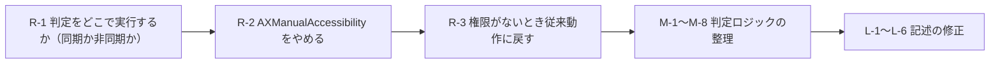
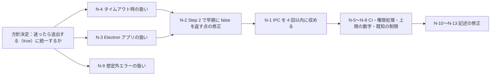

# TEXT_INPUT_DESIGN.md レビュー指摘事項

対象: [`TEXT_INPUT_DESIGN.md`](TEXT_INPUT_DESIGN.md)
照合対象: [`src/macos.rs`](src/macos.rs) / [`src/state.rs`](src/state.rs) / [`src/main.rs`](src/main.rs) / [`.github/workflows`](.github/workflows) / [`SPEC.md`](SPEC.md)

重要度の区分:
- 🔴 **重大**: 設計方針の変更が必要
- 🟠 **中**: 判定ロジックの誤り・誤判定・記述の矛盾
- 🟡 **軽微**: 記述の不正確さ・補足

---

## 🔴 重大

### R-1. 入力が止まる場所で、Accessibility IPC を同期的に何度も呼んでいる

**該当箇所**: §1.2-4、§2.2 シーケンス図、§3.1、§4.3.3、§5「フォーカス先アプリがフリーズ中」

**問題**
- `event_tap_callback` は、`kCGHIDEventTap` + `kCGEventTapOptionDefault`（入力を横取りする能動フィルタ）として登録されています（`src/macos.rs` の `run()`）。コールバックが戻るまで、**システム全体のキー・マウス入力が止まります**。
- §3.1 の判定 1 回で、次の IPC を順番に呼びます。合計 **8〜10 回**です。
  - `AXFocusedUIElement` → `AXRole` → `AXSubrole` → `IsAttributeSettable(AXSelectedTextRange)` → `IsAttributeSettable(AXValue)` → `AXFocusedApplication` → `AXTitle` → `SetAttributeValue(AXManualAccessibility)` → `AXFocusedUIElement`（取り直し）→ …
- 50ms のタイムアウトは **IPC 1 回ごと**に効くので、最悪で 400〜500ms 入力が止まります。
- そのため §1.2「通常入力時の遅延ゼロ」とも、§5「最大 50ms で `false` を返す」とも合いません。

**修正方針（どちらかを選び、設計書に明記する）**
- **案 A（同期のまま、上限を設ける）**
  - IPC の合計回数に上限を設ける（例: 最大 4 回）。
  - 判定全体の期限（例: 合計 30ms）を決め、超えた時点で打ち切って `false` にする。
  - §5 は「判定 1 回の最大所要時間 = 上限回数 × タイムアウト」と書き直す。
- **案 B（非同期化する）**
  - コールバックでは Cmd Up をすぐに返し、判定と `send_key` は別スレッド（`std::thread` + `std::sync::mpsc`、外部クレート不要）で行う。
  - トレードオフ: 「Cmd タップ直後に打った 1 文字目が、切り替え前の IME モードで入力される」競合が起こりうる。これを既知の制限として書く。
  - 副次的な利点: Cmd Up の後に英数/かなが届く順序になり、送出順が安定する。

---

### R-2. `AXManualAccessibility` を書き込むと、他アプリの動作が変わる

**該当箇所**: §3.1 Step 4

**問題**
1. **リソース消費**: 書き込むと、Electron/Chromium がアクセシビリティツリー全体を作り、維持し続けます。対象アプリの CPU とメモリが増えたままになり、SPEC.md の「極限まで軽量」と矛盾します（自プロセスではなく他プロセスの負荷ですが、利用者から見れば同じです）。
2. **VS Code / Cursor の挙動が変わる**: アクセシビリティが有効になると、VS Code はスクリーンリーダーが使われていると判断します。`editor.accessibilitySupport: auto` の場合、**スクリーンリーダー最適化モードに切り替わったり、通知が出たり**することがあります。
3. **取り直しが効かない**: ツリーの構築は非同期です。設定直後に 1 回だけ取り直しても、初回はほぼ `AXWindow` / `AXWebArea` のままと考えられます。
4. **Chrome の扱いが不正確**: `AXManualAccessibility` は Electron 独自の属性です。Chrome 本体は `AXEnhancedUserInterface` の系統で、そちらにはウィンドウ移動・アニメーションへの副作用が知られています。設計書では「Chrome」を同じ扱いにしています。
5. **毎回書き込む**: タップのたびに書き込む設計になっています。

**修正方針**
- Step 4 は**削除する**ことを推奨します。
- 代わりに、Electron 系エディタ（VS Code, Cursor, Obsidian など）は **bundle ID のホワイトリスト**で扱う（R-8 と同じ仕組みに統合する）。
- 残す場合は、少なくとも次を満たすこと:
  - 書き込みはプロセス（pid）ごとに 1 回だけ。
  - 書き込んだ回のタップは判定に使わない（次のタップから効く）。
  - 上記 2 の VS Code の副作用を §5 に明記する。

---

### R-3. アクセシビリティ権限がないときの扱いが決まっていない

**該当箇所**: §3.1 Step 6、§5

**問題**
- アクセシビリティ権限がないと、AX API はすべて `kAXErrorAPIDisabled` を返します。Step 6 で常に `false` になるため、**英数/かなが一切送出されなくなります**。
- ユーザーには「機能が壊れた」ように見えます。
- バイナリを更新して TCC の登録が無効になった場合（README の「権限（TCC）の再登録」の状況）も同じことが起こります。

**修正方針**
- 起動時に `AXIsProcessTrusted()`（ApplicationServices）で確認する。権限がない場合は:
  - stderr に警告を出す。
  - `SendImeKey` を「常に送出する」従来動作に戻す。
- 判定中に `kAXErrorAPIDisabled` を受け取った場合も、従来動作に戻す。
- §4.3.1 の FFI 宣言に `AXIsProcessTrusted` を追加する。

---

### R-4. 目的 1（Cmd 単体ショートカットとの競合）は部分的にしか解決しない

**該当箇所**: §1.1-1、§1.2、§5「Spotlight / Raycast / Alfred の検索窓」

**問題**
- 競合が一番起こりやすいのは「エディタでテキストを入力している最中」ですが、その場面では今まで通り英数/かなが割り込みます。
- §5 の記述は、問題がすべて解決したように読めてしまいます。

**修正方針**
- §1.2 または §5 に「**テキスト入力中は、Command 単体ショートカットとの競合が引き続き起こる**」と既知の制限として明記する。

---

## 🟠 中

### M-1. §3.1 と §4.2（`evaluate_focus`）で内容が食い違っている

| 項目 | §3.1（アルゴリズム） | §4.2（コード） |
| :--- | :--- | :--- |
| ターミナル判定 | Step 5 | 4 番目 |
| Electron 対応 | Step 4 | なし（純粋関数の範囲外。範囲外であることも書かれていない） |
| `AXValue` が Settable かの判定 | Step 3-2 にあり | `FocusSnapshot` に入れる場所がない |
| 非テキスト系 Role の一覧 | `AXWindow`, …, `AXToolbar`, `AXFinder` | `AXMenuBarItem`, `AXPopUpButton`, `AXScrollBar`, `AXSplitter`, `AXTabGroup`, `AXImage`, `AXIcon` を含む別の一覧 |

**修正方針**
- §3.1 の Step 番号と `evaluate_focus` 内の順序・コメント番号を揃える。
- `FocusSnapshot` に `value_settable: bool` を追加するか、Step 3-2 を削除する。
- Role の一覧は `is_non_text_control_role` を正とし、本文はそれを参照する形にする。
- 「Step 2 で非テキスト系 Role なら Step 3 を飛ばす」という本文の制御と、コードの `excluded` 判定が同じ意味になるよう、書き方を統一する。

### M-2. 実在しない Role `AXFinder` が書かれている

**該当箇所**: §3.1 Step 2 の後段

- `AXFinder` という Role は存在しません。Finder のリスト・アイコン表示で実際に返る Role は `AXList` / `AXOutline` / `AXTable` / `AXBrowser` / `AXGroup` です。

### M-3. 非テキスト系 Role の除外リストに抜けがある

**該当箇所**: §4.2 `is_non_text_control_role`

- 次の Role を追加する: `AXList`, `AXOutline`, `AXTable`, `AXBrowser`, `AXRow`, `AXCell`, `AXGrid`, `AXLink`, `AXWebArea`, `AXStaticText`, `AXScrollArea`。
- 理由: Safari などでは、編集できないページ（`AXWebArea` / `AXStaticText`）でも `AXSelectedTextRange` が Settable になることがあります。そうなると **ブラウジング中に `true` と判定**されるおそれがあります。
- 注意: `contenteditable` は Chromium/WebKit では `AXTextArea`（または `AXGroup` + Settable）になるので、`AXWebArea` を除外しても影響しません。§3.1 の表に書かれている `contenteditable → AXTextArea` と整合します。

### M-4. 読み取り専用のテキスト欄まで `true` になる

**該当箇所**: §3.1 Step 2、§4.2 `is_text_role`

- 読み取り専用の `NSTextView`（Xcode のコンソール、ログ表示、各種ビューア）や、編集できない `NSTextField` も `AXTextArea` / `AXTextField` を返します。Role だけで判定すると誤って `true` になります。
- **修正方針**:
  - `AXTextField` / `AXTextArea` については、`AXValue` が Settable かどうかを併せて確認する。
  - ただし、Settable を正しく返さないアプリがある場合に備え、この確認を必須にするかどうかは実機で確かめたうえで決め、その結果を設計書に残す。

### M-5. ターミナルをアプリ名（`AXTitle`）で判定するのは不安定

**該当箇所**: §3.1 Step 5、§4.2 `is_terminal_app`、`FocusSnapshot::app_title`

**問題**
- アプリ要素の `AXTitle` は、端末の言語設定で変わる表示名です（「ターミナル」を個別に追加している理由もこれです）。
- `"Rio"` `"Hyper"` `"Warp"` `"Tabby"` のような一般的な単語は、他のアプリ名とぶつかるおそれがあります。
- Terminal.app と iTerm2 はもともと `AXTextArea` を公開しているので、ホワイトリストに入れる必要がありません。

**修正方針**
- `AXUIElementGetPid` で pid を取り、bundle ID（または実行ファイルのパス）で判定する。
  - 外部クレートなしで済ませるなら、`proc_pidpath`（libSystem）で実行ファイルのパスを取り、`.app` のパスで照合する方法がある。
- 例: `com.mitchellh.ghostty`, `com.github.wez.wezterm`, `org.alacritty`, `net.kovidgoyal.kitty`, `dev.warp.Warp-Stable`, `co.zeit.hyper`, `com.raphaelamorim.rio`, `org.tabby`
- `FocusSnapshot.app_title` は `app_id`（bundle ID または実行ファイル名）に名前を変える。

### M-6. ターミナルの例外がメニュー以外のフォーカスにも効いてしまう

**該当箇所**: §4.2 `evaluate_focus` の 4 番目

- ターミナルアプリの中であれば、設定ウィンドウのボタン（`AXButton`）やチェックボックスにフォーカスがあっても `true` になります。
- **修正方針**: 例外を適用する条件を「Role が `AXWindow` / `AXGroup` / `AXScrollArea` / `None` の場合」に絞るなど、適用範囲を明確にする。

### M-7. 失敗時の扱いが箇所によって矛盾している

**該当箇所**: §3.1 Step 1（取得に失敗したらターミナル判定へ） vs Step 6（エラー・タイムアウトなら `false`）

**問題**
- アプリがフリーズしている場合、`AXFocusedUIElement` のタイムアウト（50ms）に続けて `AXFocusedApplication` / `AXTitle` の取得でもタイムアウトを待つことになり、入力が止まる時間が倍になります（R-1 と関連）。

**修正方針**
- `kAXErrorCannotComplete`（タイムアウト）の場合は**その場で `false` を返し、以降の IPC は行わない**。
- `kAXErrorNoValue` など、応答はあったが値がない場合だけ、ターミナル判定に進む。

### M-8. 取り直す対象の要素が適切でない

**該当箇所**: §3.1 Step 4-3

- `AXManualAccessibility` を設定した後に取り直すのは、システム全体の要素ではなく、**取得したアプリ要素の `AXFocusedUIElement`** にすべきです（R-2 で Step 4 自体を削除する場合は不要）。

---

## 🟡 軽微

### L-1. 「Linux CI」という記述が事実と違う

**該当箇所**: §1.2-4、§6.1 見出し

- CI（`.github/workflows`）は `macos-latest` だけで動いています。SPEC.md も「macOS が必要なビルドやテストは GitHub Actions を用いて実行する」としています。
- **修正方針**:
  - 「OS 非依存の純粋関数として分離し、`cargo test` で検証可能にする」と書き直す。
  - `cargo clippy --all-targets -- -D warnings` が通ることを要件に加える（`text_input` モジュールは `#[cfg]` で限定せず `pub mod` にするので、未使用警告は出ない想定）。

### L-2. 「ヒープ確保ゼロ」は言い過ぎ

**該当箇所**: §4.2 冒頭、§4.3.2

- `AXUIElementCopyAttributeValue` や `CFStringCreateWithBytesNoCopy` 自体が CF オブジェクト（ヒープ）を確保します。
- 正確には「**Rust 側で `String` / `CString` を確保しない**」です。そのように書き直す。

### L-3. 属性名の CFString をいつ作るかが決まっていない

**該当箇所**: §4.3.2-1（「スコープ終了時に `CFRelease` する（または起動時に一度だけ生成して `AtomicPtr` に保持する）」）

- 両案が併記されています。**起動時に一度だけ作り、終了時に解放する**方に統一する。
- 補足: Role などの比較は、CFString 同士の `CFEqual` で済ませる方法もある（純粋関数のインターフェースは `&str` のままでよい）。

### L-4. 文字列バッファ `[u8; 128]` の上限を書く

**該当箇所**: §4.3.2-2

- 128 バイトを超える文字列は `CFStringGetCString` が失敗し、`None` になります。この挙動を明記する（Role や bundle ID なら十分な長さ）。

### L-5. 既存テストの書き換えを明記する

**該当箇所**: §6.1

- `src/state.rs` の既存テストのうち、`Action::SendKey(KEY_JIS_EISU)` / `Action::SendKey(KEY_JIS_KANA)` を確認しているもの（`test_command_tap_works_when_capslock_is_locked_on` など）は、`SendImeKey` に書き換えが必要です。「既存テストの修正」として項目を追加する。

### L-6. テスト計画に追加すべきケース

**該当箇所**: §6.1 / §6.2

単体テスト:
- 読み取り専用の `AXTextArea` で、`value_settable = false` なら `false` になること（M-4）。
- `AXWebArea` / `AXStaticText` / `AXList` で `selected_text_range_settable = true` でも `false` になること（M-3）。
- ターミナルアプリで `AXButton` にフォーカスがあるとき `false` になること（M-6）。

実機確認:
- アクセシビリティ権限を外した状態で、従来動作に戻ること（R-3）。
- アプリをフリーズさせた状態（例: `kill -STOP <pid>`）で Cmd をタップし、入力が止まる時間が上限内に収まること（R-1）。
- VS Code で、スクリーンリーダー最適化モードに切り替わらないこと（R-2）。

---

## 対応の優先順位

R-1〜R-3 で方針が決まれば、§3.1 と §4.2 の食い違い（M-1）は、まとめて書き直すことで解消できます。

---
---

# 第2回レビュー（修正版 TEXT_INPUT_DESIGN.md に対する指摘）

対象: 修正後の [`TEXT_INPUT_DESIGN.md`](TEXT_INPUT_DESIGN.md)（2026-11-08 版）

## 第1回指摘の対応状況

| 指摘 | 状況 | 備考 |
| :--- | :--- | :--- |
| R-1 入力が止まる場所での同期 IPC | ✅ 対応（案 A：同期のまま上限を設ける） | IPC 回数の上限と数字の表記に新たな問題あり（N-1, N-7） |
| R-2 `AXManualAccessibility` の副作用 | ✅ 対応（削除し、ホワイトリスト方式へ） | ホワイトリスト方式に起因する新たな問題あり（N-3, N-8） |
| R-3 権限がないときの扱い | ✅ 対応 | その処理に実際に到達するかの確認が必要（N-6） |
| R-4 テキスト入力中の競合が残る | ✅ 対応（既知の制限として明記） | |
| M-1〜M-8 | ✅ 対応 | Step 2 で早期に `return false` する点に新たな問題あり（N-2） |
| L-1〜L-6 | ✅ 対応 | |

新しい指摘のうち N-1〜N-4 は、**日本語入力ができなくなる（英数/かなが出ない）方向の失敗**につながるため、優先して直す必要があります。

---

## 🔴 重大

### N-1. 「IPC は最大 4 回」が守られていない

**該当箇所**: §1.2-5、§3.1-3（IPC #4）、§2.2 シーケンス図

**問題**
- `role` が `AXTextField` / `AXTextArea` の場合、呼び出しは次のようになり、**最大 5 回**になります。

  | # | 呼び出し |
  | :--- | :--- |
  | 1 | `AXFocusedUIElement` |
  | 2 | `AXRole` |
  | 3 | `AXSubrole` |
  | 4 | `IsAttributeSettable(AXValue)` |
  | 5 | （#4 が false の場合）`IsAttributeSettable(AXSelectedTextRange)` |

- 「合計 IPC 4 回以内」という記述と食い違っています。

**修正方針**
- Role と Subrole は `AXUIElementCopyMultipleAttributeValues`（ApplicationServices）で **1 回の IPC にまとめて**取得する。これで最大 4 回に収まります。
  - `options = 0` で呼ぶと、取得できなかった属性は `AXValueRef`（`kAXValueAXErrorType`）として返ってきます。そのため、配列の各要素について型を確認する処理が必要です。
- §4.3.1 の FFI 宣言に、`AXUIElementCopyMultipleAttributeValues` と、CFArray を扱う関数（`CFArrayGetCount` / `CFArrayGetValueAtIndex`）を追加する。

---

### N-2. Terminal.app / iTerm2 で英数/かなが出なくなるおそれ

**該当箇所**: §3.2 Step 2、§4.2 `evaluate_focus`、`is_app_fallback_container_role`

**問題**
- Terminal.app と iTerm2 は `AXTextArea` を公開しています。ただしその `AXValue` は**画面の中身（スクロールバック）を表すため、Settable にならない**可能性が高いです。
- Step 2 では `"AXTextField" | "AXTextArea" => return value_settable || selected_text_range_settable;` と**その場で結果を返す**ため、両方 `false` なら `false` で終わります。**Step 4（ホワイトリスト）に進みません**。
- `is_app_fallback_container_role` にも `AXTextArea` が入っていないので、どちらにしても救われません。
- Ghostty などが今後のバージョンで `AXTextArea` を公開した場合も、同じことが起こります。

**修正方針（どちらか）**
- **案 A**: ホワイトリストに載っているアプリ（`is_text_centric_app`）の判定を Step 2 より**前**に行う。その場合の対象 Role は「コンテナ系の Role、または `AXTextArea`」とする。
- **案 B**: Step 2 では、読み取り専用と判断しても `return false` せず、Step 3 以降に進める（`true` の場合だけ早期に返す）。そのうえで `is_app_fallback_container_role` に `AXTextArea` を追加する。
- §6.1 に「`Terminal.app` で `AXTextArea`・`value_settable = false` のとき `true` になること」のテストを追加する。

---

### N-3. ホワイトリストにない Electron アプリで英数/かなが出なくなる

**該当箇所**: §3.2 Step 4、§4.2 `is_text_centric_app`、§5「VS Code / Electron系アプリの副作用防止」

**問題**
- Step 4 自身が書いているとおり、`AXManualAccessibility` を書き込まない限り、Electron アプリは中の入力欄を公開しません。
- そのため、ホワイトリストにない **Slack / Discord / Notion / Microsoft Teams / ChatGPT / Claude / Figma** などでは、テキスト入力中でも常に `false` になり、**英数/かなが一切出なくなります**。
- 日本語ユーザーにとって、これは元の問題（非テキスト時に IME が切り替わる）より深刻な後退です。
- Chrome / Edge / Brave などの Chromium 系ブラウザでも、同じことが起きないか実機で確かめる必要があります（AX クライアントが問い合わせるまで、中を公開しない動作をするため）。

**修正方針（どれかを選び、設計書に明記する）**
- **案 A（推奨）: Electron アプリであれば、迷ったら送出する（`true`）**
  - `proc_pidpath` で得たバンドルのパスに `Contents/Frameworks/Electron Framework.framework` があるかどうかで Electron アプリを判定する。
  - 確認には `access(2)` / `stat(2)` を使う（libSystem なので外部クレート不要）。結果は pid ごとに保存し、2 回目以降はシステムコールを呼ばない。
  - Electron アプリで Role が `None` / `AXWindow` / `AXWebArea` / `AXGroup` なら `true` にする。
  - `FocusSnapshot` に `is_electron: bool` を追加すれば、判定は純粋関数のまま書ける。
- **案 B**: `is_text_centric_app` に主要な Electron アプリを片っ端から追加する（漏れが出やすく、保守もしにくい）。
- **案 C**: 既知の制限として §1.2 と §5 に明記する（推奨しない）。

---

### N-4. タイムアウトしたら `false` にする設計は、損な側に倒れている

**該当箇所**: §1.2-5、§3.1-2、§2.2 シーケンス図（`else 非テキスト入力時 (またはアプリ応答タイムアウト時)`）、§5「フォーカス先アプリがフリーズ中」

**問題**
- IPC 1 回あたり 10ms という上限は、Xcode のビルド中や Electron アプリの負荷が高いときなど、**普通に動いているアプリでも超えることがあります**。そのたびに `false` になり、英数/かなが出ない「取りこぼし」が起きます。
- 一方、フリーズしたアプリに英数/かなを送っても**害はありません**。キューに溜まるか捨てられるだけです。そもそもフリーズ中のアプリでは、Cmd 単体ショートカットとの競合も問題になりません。
- つまり、失敗した場合を比べると次のとおりで、タイムアウト時は「送る」側に倒すほうが損が小さくなります。

  | タイムアウト時の扱い | 判断を誤ったときの影響 |
  | :--- | :--- |
  | `false`（送出しない） | 日本語入力モードを切り替えられない（影響大） |
  | `true`（送出する） | IME が不要に切り替わる（元の挙動と同じ・影響小） |

**修正方針**
- `kAXErrorCannotComplete` を受け取ったとき、および全体の期限切れのときは **`true`（送出する）** を返す。
- この「迷ったら送出する」方針を §1.2 に明記し、§2.2・§3.1・§5・§6.2 の記述をすべてそれに合わせる。

---

## 🟠 中

### N-5. `type pid_t = i32;` で CI が通らない

**該当箇所**: §4.3.1

- Rust の命名規則の警告（`non_camel_case_types`）が出ます。そのため、§1.2-5 で必須とした `cargo clippy --all-targets -- -D warnings` が失敗します。
- **修正方針**: `type PidT = i32;` に変えるか、`#[allow(non_camel_case_types)]` を付ける。

### N-6. 権限がないときの処理（R-3 の対応）に、実際に到達するか確認が必要

**該当箇所**: §1.2-4、§3.1-1、§5「アクセシビリティ権限が未付与 / TCC失効」、§6.2-3

**問題**
- `kCGHIDEventTap` + `kCGEventTapOptionDefault`（入力を横取りする方式）の監視は、アクセシビリティ権限がないと**作成自体に失敗する**はずです。その場合 `run()` はエラーで終了するので、従来動作に戻す処理には**起動時点では到達しません**。
- 起動時の `AXIsProcessTrusted()` の結果を、再起動まで使い続けるのかどうかも書かれていません。

**修正方針**
- 権限がない状態で監視を作成できるかを実機で確かめ、結果を設計書に残す。
- そのうえで、従来動作に戻す処理が働く場面を明記する。例: 「実行中に権限を外された場合（実行中の IPC が `kAXErrorAPIDisabled` を返したとき）」。
- 起動時の結果を保存しておくのか、`kAXErrorAPIDisabled` を受け取るたびに判断するのかを明記する。
- §6.2-3 の「権限を OFF にした状態で起動」は、起動に失敗するのが正しい結果である可能性があるため、確認手順を見直す（起動後に権限を OFF にする手順にする）。

### N-7. 上限時間の数字が箇所によって違う

**該当箇所**: §1.2-5（全体 30ms）、§5（最悪でも 30〜40ms 以内）、§6.2-3（約 10〜30ms 以内）

- 30ms の期限は IPC と IPC の**間**でしか確かめられません。そのため、最悪は「29.9ms の時点で始まった IPC が、さらに 10ms かかる」場合で、**約 40ms** になります。
- **修正方針**: 上限を「判定全体で最悪 40ms（期限 30ms + IPC 1 回の上限 10ms）」に統一し、§1.2・§2.2・§5・§6.2 に同じ数字を書く。

### N-8. VS Code などのホワイトリストのアプリは、ほぼどこでも `true` になる

**該当箇所**: §3.2 Step 4、§5

**問題**
- VS Code などが中を公開していない場合、サイドバー・検索パネル・内蔵ターミナルのどこにフォーカスがあっても、Role は `AXWebArea` / `AXGroup` / `AXWindow` になります。そのため、**ウィンドウ内のほぼどこでも `true`** になります。
- 逆に、別のツール（VoiceOver、Homerow、Rectangle Pro など）が VS Code の公開を有効にしている環境では、次のように**判定結果が変わります**。
  - エディタ（隠れた `textarea`）→ `AXTextArea` → `true`
  - ファイルツリー（`AXOutline` / `AXRow`）→ `false`
- どちらも意図した動作と言えなくはないものの、既知の制限として書かれていません。

**修正方針**
- §5 に「ホワイトリストのアプリは、中の公開状態によって判定の細かさが変わる」ことを既知の制限として追記する。

### N-9. 想定外の AX エラーを受け取ったときの扱いが決まっていない

**該当箇所**: §3.1

- 扱いが決まっているのは `kAXErrorSuccess` / `kAXErrorNoValue` / `kAXErrorAttributeUnsupported` / `kAXErrorCannotComplete` / `kAXErrorAPIDisabled` だけです。
- `kAXErrorFailure`(-25200) / `kAXErrorIllegalArgument`(-25201) / `kAXErrorInvalidUIElement`(-25202) / `kAXErrorNotImplemented`(-25208) などを受け取ったときの扱いがありません。
- **修正方針**: 「上記以外のエラーは IPC を打ち切り、○○を返す」と明記する。○○は N-4 の方針に合わせて、`true` にするかどうかを決める。

---

## 🟡 軽微

### N-10. システム全体の要素の作成と解放の説明が消えた

**該当箇所**: §4.3.2 / §4.3.3

- 修正前の §4.3.3 にあった次の説明が、修正で抜けています。
  - `AXUIElementCreateSystemWide()` を起動時に作る
  - `AXUIElementSetMessagingTimeout` を設定する
  - `AtomicPtr` に保持し、終了時に `CFRelease` する
- §4.3.2 に戻してください。

### N-11. `PATH_BUF_SIZE` には下限がある

**該当箇所**: §4.3.1 `PATH_BUF_SIZE`

- `proc_pidpath` は、バッファが `PROC_PIDPATHINFO_SIZE`（= `MAXPATHLEN` = 1024）未満だと `ENOMEM` で失敗します。**1024 が下限**であることをコメントに書いておく。
- 1024 バイトを超えるパスは `None` 扱いになることも書いておく（上限の `PROC_PIDPATHINFO_MAXSIZE` は 4096）。

### N-12. 実機確認項目に追加したいもの

**該当箇所**: §6.2

- Terminal.app / iTerm2 で英数/かなに切り替わること（N-2）。
- Slack / Discord / Notion など、ホワイトリストにない Electron アプリの入力欄で切り替わること（N-3）。
- Chrome / Edge の入力欄で切り替わること（N-3）。
- Web の contenteditable（Google Docs、Gmail の作成画面、Notion の Web 版）で切り替わること。
- 負荷が高いとき（Xcode のビルド中など）に、取りこぼしが起きないこと（N-4）。

### N-13. 誤記

- §6.2-2「メモ帳」→ macOS のアプリ名は「メモ」。

---

## 第2回の対応の優先順位

N-2〜N-4 と N-9 は、どれも「判定に自信がないとき、`true` と `false` のどちらに倒すか」という方針の問題です。

- 本機能の目的は、**非テキスト入力時の不要な IME 切り替えと、Cmd 単体ショートカットとの競合を減らすこと**です。英数/かなが出ないこと（日本語入力ができなくなること）は、その目的より重い失敗です。
- そのため、**「確実に非テキスト入力と判断できた場合だけ送出しない（それ以外は `true`）」**という方針に統一することを推奨します。
